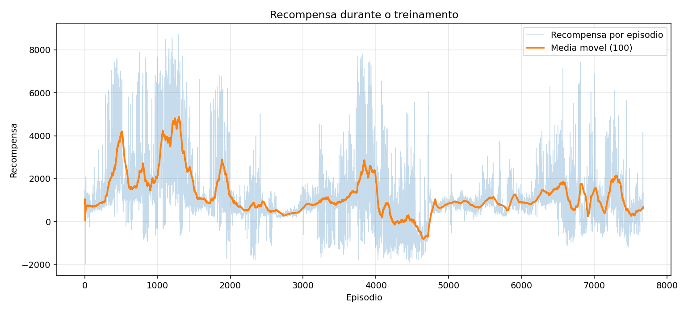
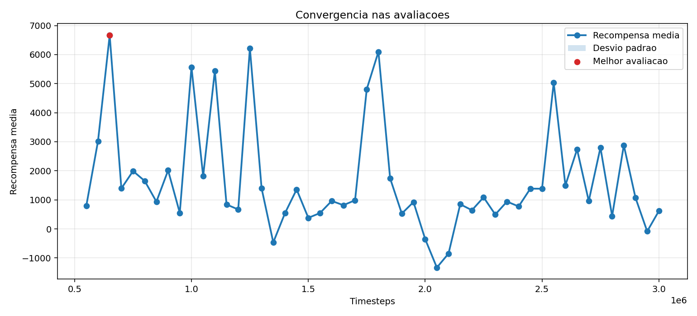
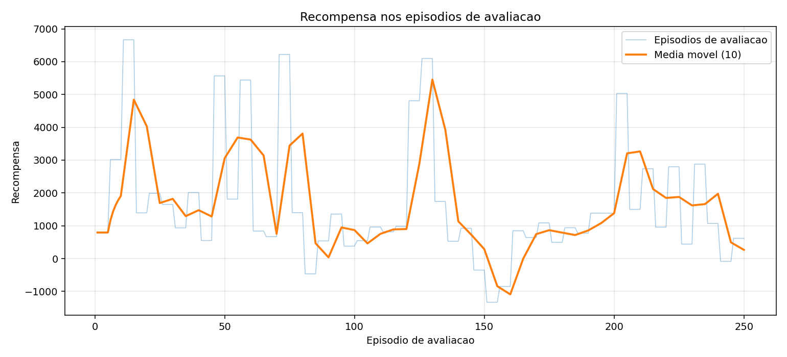

# treino_gait_andando_v3_frente_certa_PROTEGIDO_NAO_APAGAR

Backup protegido do treino `treino_gait_andando_v3_frente_certa`. Nao apagar nem sobrescrever.

- Registrado em: `2026-09-16T02:32:27.978589+00:00`
- Origem: `reinforcement_learning/saida_optuna_atom/treino_gait_andando_v3_frente_certa_PROTEGIDO_NAO_APAGAR`
- Device: `cuda`
- Timesteps finais: `2500000`
- Frequencia de avaliacao: `50000`
- Episodios por avaliacao: `5`
- Gait inicial: `True`
- Modo gait parado: `False`
- Modo gait andando: `True`

## Modelos

- Melhor avaliacao: `reinforcement_learning/melhores_modelos/treino_gait_andando_v3_frente_certa_PROTEGIDO_NAO_APAGAR/best_model.zip`
- Modelo final: `reinforcement_learning/melhores_modelos/treino_gait_andando_v3_frente_certa_PROTEGIDO_NAO_APAGAR/final_model.zip`

## Graficos





## Ambiente e recompensa usados

- Ambiente completo: `env_snapshot/env_usado_no_treino.py`
- Funcao de recompensa exata: `env_snapshot/FUNCAO_RECOMPENSA_EXATA_USADA.md`
- Modelo MuJoCo usado: `env_snapshot/model/scene.xml` e `env_snapshot/model/robot.xml`
- Manifesto do snapshot: `env_snapshot/README.md`

## Ver no MuJoCo

```bash
python reinforcement_learning/ver_modelo_atom.py --modelo reinforcement_learning/melhores_modelos/treino_gait_andando_v3_frente_certa_PROTEGIDO_NAO_APAGAR/best_model.zip --usar-gait-inicial --modo-gait-andando
```

## TensorBoard

```bash
tensorboard --logdir reinforcement_learning/saida_optuna_atom/treino_gait_andando_v3_frente_certa_PROTEGIDO_NAO_APAGAR/logs
```

## Parametros PPO

```json
{
  "learning_rate": 0.0008286946154789709,
  "n_steps": 512,
  "batch_size": 64,
  "n_epochs": 10,
  "gamma": 0.98,
  "gae_lambda": 0.95,
  "clip_range": 0.137826935848043,
  "ent_coef": 0.0,
  "vf_coef": 0.32937558580716303,
  "max_grad_norm": 0.5222902926081441
}
```

## Avaliacao

```json
{
  "train_monitor": {
    "episodes": 7672,
    "last_reward": 1340.331197,
    "best_episode_reward": 8705.131828,
    "mean_last_10_reward": 1307.5591379000002,
    "last_episode_length": 552,
    "elapsed_seconds": 2991.239798
  },
  "eval_monitor": {
    "episodes": 250,
    "last_reward": 616.167193,
    "best_episode_reward": 6666.861145,
    "mean_last_10_reward": 265.960333,
    "last_episode_length": 145,
    "elapsed_seconds": 2991.781786
  },
  "evaluations_npz": {
    "path": "reinforcement_learning/saida_optuna_atom/treino_gait_andando_v3_frente_certa_PROTEGIDO_NAO_APAGAR/logs/evaluations.npz",
    "num_evaluations": 50,
    "best_mean_reward": 6666.861145,
    "best_timestep": 650000,
    "last_mean_reward": 616.167193,
    "last_timestep": 3000000
  }
}
```
