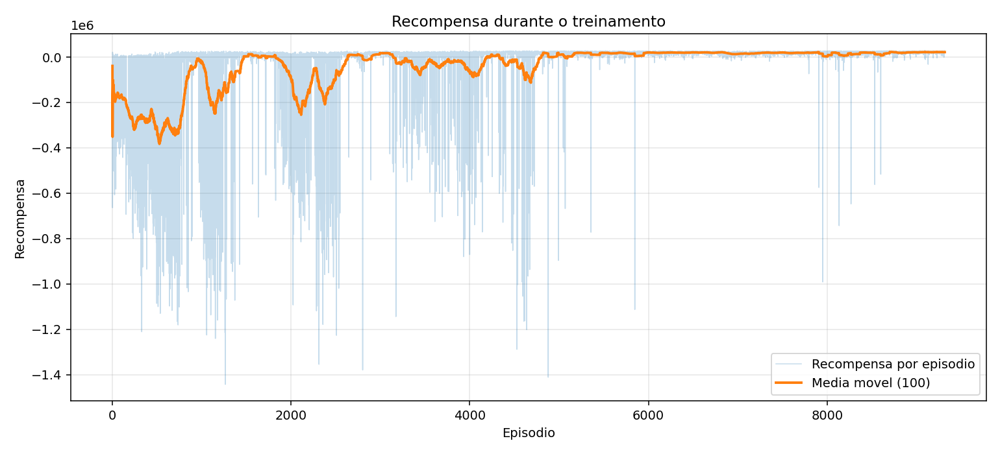
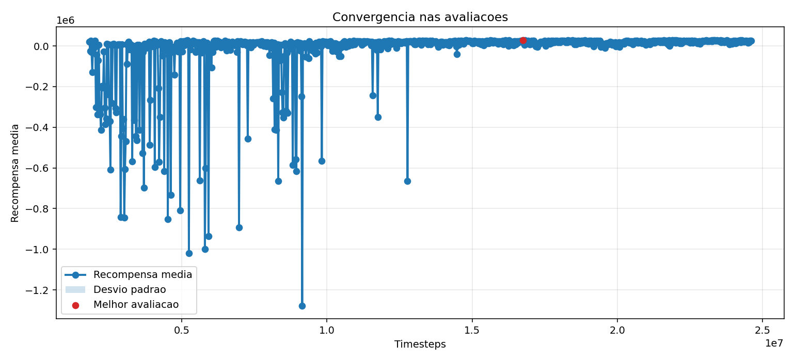
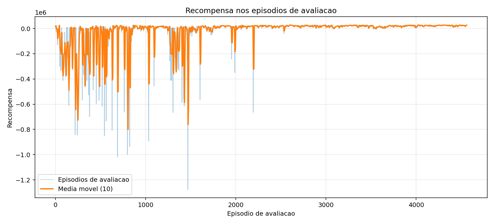

# treino_walking_cadencia_original_direcao_v5_parcial_PROTEGIDO_NAO_APAGAR

- Registrado em: `2026-10-28T13:27:01.784570+00:00`
- Origem: `reinforcement_learning/saida_optuna_atom/treino_walking_cadencia_original_direcao_v5`
- Device: `cuda`
- Timesteps finais: `None`
- Frequencia de avaliacao: `None`
- Episodios por avaliacao: `None`
- Gait inicial: `True`
- Modo gait parado: `False`
- Modo gait andando: `True`

## Modelos

- Melhor avaliacao: `reinforcement_learning/melhores_modelos/treino_walking_cadencia_original_direcao_v5_parcial_protegido_nao_apagar/best_model.zip`

## Snapshot do ambiente

- Ambiente carregavel: `reinforcement_learning/melhores_modelos/treino_walking_cadencia_original_direcao_v5_parcial_protegido_nao_apagar/env_snapshot/atom/env.py`
- Ambiente documentado: `reinforcement_learning/melhores_modelos/treino_walking_cadencia_original_direcao_v5_parcial_protegido_nao_apagar/env_snapshot/env_usado_no_treino.py`
- Funcao de recompensa: `reinforcement_learning/melhores_modelos/treino_walking_cadencia_original_direcao_v5_parcial_protegido_nao_apagar/env_snapshot/FUNCAO_RECOMPENSA_EXATA_USADA.md`
- Manifesto: `reinforcement_learning/melhores_modelos/treino_walking_cadencia_original_direcao_v5_parcial_protegido_nao_apagar/env_snapshot/manifest.json`

## Graficos





## Ver no MuJoCo

```bash
python reinforcement_learning/ver_modelo_atom.py --modelo reinforcement_learning/melhores_modelos/treino_walking_cadencia_original_direcao_v5_parcial_protegido_nao_apagar/best_model.zip --usar-env-snapshot --usar-gait-inicial --modo-gait-andando
```

## TensorBoard

```bash
tensorboard --logdir /home/rafaelaaltheman/Projetos/TCC_Aprendizado_por_reforco_robo_humanoide_simulacao_MuJoCo/reinforcement_learning/melhores_modelos/treino_walking_cadencia_original_direcao_v5_parcial_protegido_nao_apagar/logs
```

## Parametros PPO

```json
{
  "learning_rate": 1e-05,
  "n_steps": 512,
  "batch_size": 64,
  "n_epochs": 10,
  "gamma": 0.98,
  "gae_lambda": 0.95,
  "ent_coef": 0.0,
  "vf_coef": 0.32937558580716303,
  "max_grad_norm": 0.5222902926081441
}
```

## Avaliacao

```json
{
  "train_monitor": {
    "episodes": 9317,
    "last_reward": 22193.359599,
    "best_episode_reward": 28693.97266,
    "mean_last_10_reward": 23532.986892499997,
    "last_episode_length": 2004,
    "elapsed_seconds": 45249.242218
  },
  "eval_monitor": {
    "episodes": 4560,
    "last_reward": 26308.276107,
    "best_episode_reward": 28125.755464,
    "mean_last_10_reward": 26147.214254500002,
    "last_episode_length": 1931,
    "elapsed_seconds": 45245.353739
  },
  "evaluations_npz": {
    "path": "/home/rafaelaaltheman/Projetos/TCC_Aprendizado_por_reforco_robo_humanoide_simulacao_MuJoCo/reinforcement_learning/melhores_modelos/treino_walking_cadencia_original_direcao_v5_parcial_protegido_nao_apagar/logs/evaluations.npz",
    "num_evaluations": 912,
    "best_mean_reward": 28125.755463999998,
    "best_timestep": 16750000,
    "last_mean_reward": 26308.276107,
    "last_timestep": 24600000
  }
}
```
