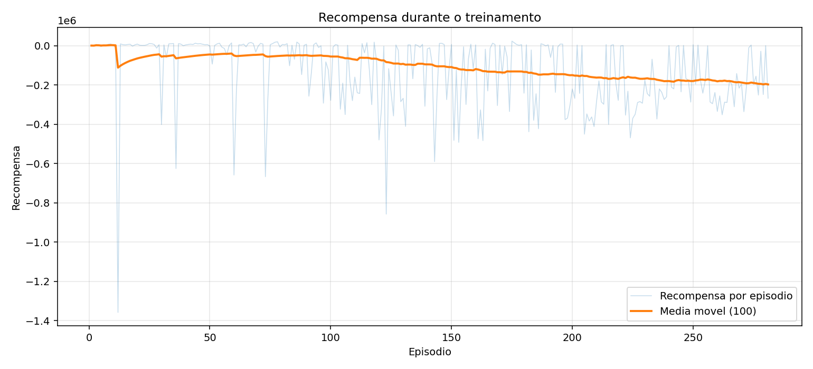
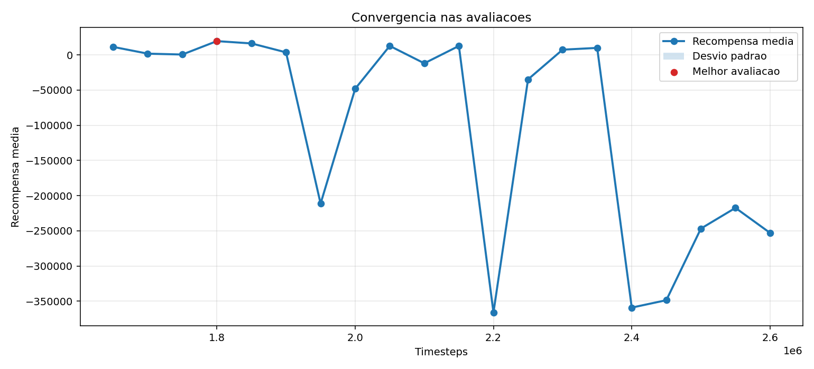
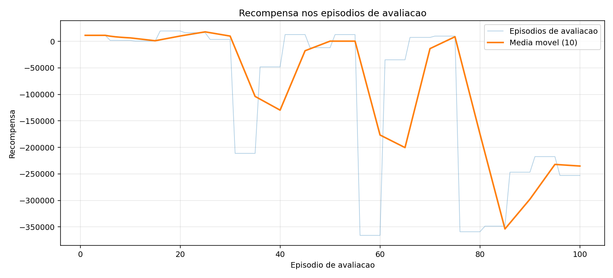

# treino_walking_equilibrio_frente_60s_v1

- Registrado em: `2026-10-26T23:19:03.648971+00:00`
- Origem: `reinforcement_learning/saida_optuna_atom/treino_walking_equilibrio_frente_60s_v1`
- Device: `cuda`
- Timesteps finais: `1000000`
- Frequencia de avaliacao: `50000`
- Episodios por avaliacao: `5`
- Gait inicial: `True`
- Modo gait parado: `False`
- Modo gait andando: `True`

## Modelos

- Melhor avaliacao: `reinforcement_learning/melhores_modelos/treino_walking_equilibrio_frente_60s_v1/best_model.zip`
- Modelo final: `reinforcement_learning/melhores_modelos/treino_walking_equilibrio_frente_60s_v1/final_model.zip`

## Snapshot do ambiente

- Ambiente carregavel: `reinforcement_learning/melhores_modelos/treino_walking_equilibrio_frente_60s_v1/env_snapshot/atom/env.py`
- Ambiente documentado: `reinforcement_learning/melhores_modelos/treino_walking_equilibrio_frente_60s_v1/env_snapshot/env_usado_no_treino.py`
- Funcao de recompensa: `reinforcement_learning/melhores_modelos/treino_walking_equilibrio_frente_60s_v1/env_snapshot/FUNCAO_RECOMPENSA_EXATA_USADA.md`
- Manifesto: `reinforcement_learning/melhores_modelos/treino_walking_equilibrio_frente_60s_v1/env_snapshot/manifest.json`

## Graficos





## Ver no MuJoCo

```bash
python reinforcement_learning/ver_modelo_atom.py --modelo reinforcement_learning/melhores_modelos/treino_walking_equilibrio_frente_60s_v1/best_model.zip --usar-env-snapshot --usar-gait-inicial --modo-gait-andando
```

## TensorBoard

```bash
tensorboard --logdir reinforcement_learning/saida_optuna_atom/treino_walking_equilibrio_frente_60s_v1/logs
```

## Parametros PPO

```json
{
  "learning_rate": 3e-05,
  "n_steps": 512,
  "batch_size": 64,
  "n_epochs": 10,
  "gamma": 0.98,
  "gae_lambda": 0.95,
  "clip_range": 0.137826935848043,
  "ent_coef": 0.0,
  "vf_coef": 0.32937558580716303,
  "max_grad_norm": 0.5222902926081441
}
```

## Avaliacao

```json
{
  "train_monitor": {
    "episodes": 281,
    "last_reward": -267481.941671,
    "best_episode_reward": 23117.203627,
    "mean_last_10_reward": -136929.02821770002,
    "last_episode_length": 6000,
    "elapsed_seconds": 4134.493831
  },
  "eval_monitor": {
    "episodes": 100,
    "last_reward": -252893.01362,
    "best_episode_reward": 19553.251467,
    "mean_last_10_reward": -235124.56545549998,
    "last_episode_length": 6000,
    "elapsed_seconds": 4165.992857
  },
  "evaluations_npz": {
    "path": "reinforcement_learning/saida_optuna_atom/treino_walking_equilibrio_frente_60s_v1/logs/evaluations.npz",
    "num_evaluations": 20,
    "best_mean_reward": 19553.251467,
    "best_timestep": 1800000,
    "last_mean_reward": -252893.01362,
    "last_timestep": 2600000
  }
}
```
