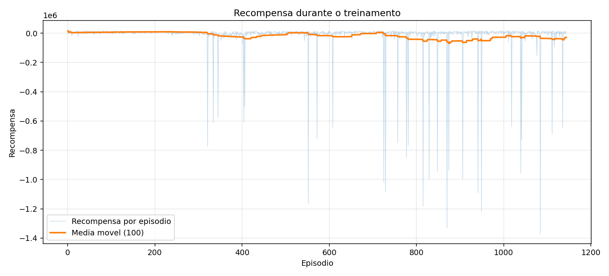
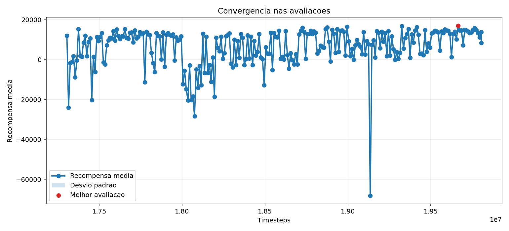
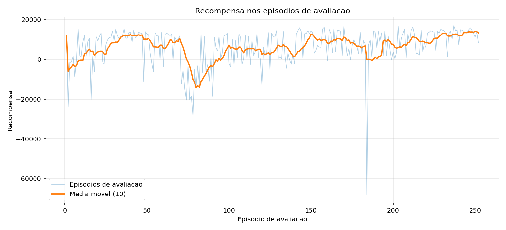

# treino_walking_rapido_v18

- Registrado em: `2026-11-03T16:32:20.643559+00:00`
- Origem: `reinforcement_learning/saida_optuna_atom/treino_walking_rapido_v18`
- Device: `cpu`
- Timesteps finais: `2500000`
- Frequencia de avaliacao: `10000`
- Episodios por avaliacao: `1`
- Gait inicial: `True`
- Modo gait parado: `False`
- Modo gait andando: `True`

## Modelos

- Melhor avaliacao: `reinforcement_learning/melhores_modelos/treino_walking_rapido_v18/best_model.zip`
- Modelo final: `reinforcement_learning/melhores_modelos/treino_walking_rapido_v18/final_model.zip`

## Velocidade ate o alvo

Selecao: maior velocidade com chegada ao alvo em todos os episodios e zero quedas.
- Velocidade media de progresso: `0.2697 m/s`
- Tempo medio ate o alvo: `17.43 s`
- Timesteps do checkpoint selecionado: `18975000`

## Snapshot do ambiente

- Ambiente carregavel: `reinforcement_learning/melhores_modelos/treino_walking_rapido_v18/env_snapshot/atom/env.py`
- Ambiente documentado: `reinforcement_learning/melhores_modelos/treino_walking_rapido_v18/env_snapshot/env_usado_no_treino.py`
- Funcao de recompensa: `reinforcement_learning/melhores_modelos/treino_walking_rapido_v18/env_snapshot/FUNCAO_RECOMPENSA_EXATA_USADA.md`
- Manifesto: `reinforcement_learning/melhores_modelos/treino_walking_rapido_v18/env_snapshot/manifest.json`

## Graficos





## Ver no MuJoCo

```bash
python reinforcement_learning/ver_modelo_atom.py --modelo reinforcement_learning/melhores_modelos/treino_walking_rapido_v18/best_model.zip --usar-env-snapshot --usar-gait-inicial --modo-gait-andando --modo-gait-rapido --velocidade-alvo 0.35 --periodo-gait 68
```

## TensorBoard

```bash
tensorboard --logdir reinforcement_learning/saida_optuna_atom/treino_walking_rapido_v18/logs
```

## Parametros PPO

```json
{
  "learning_rate": 1e-05,
  "n_steps": 512,
  "batch_size": 64,
  "n_epochs": 5,
  "gamma": 0.995,
  "gae_lambda": 0.98,
  "clip_range": 0.08,
  "ent_coef": 0.0,
  "vf_coef": 0.32937558580716303,
  "max_grad_norm": 0.5222902926081441,
  "target_kl": 0.005
}
```

## Avaliacao

```json
{
  "train_monitor": {
    "episodes": 1143,
    "last_reward": 10972.221827,
    "best_episode_reward": 16653.895328,
    "mean_last_10_reward": -63986.956354,
    "last_episode_length": 1877,
    "elapsed_seconds": 6378.643851
  },
  "eval_monitor": {
    "episodes": 252,
    "last_reward": 8363.853362,
    "best_episode_reward": 16976.320958,
    "mean_last_10_reward": 13330.294658399998,
    "last_episode_length": 2106,
    "elapsed_seconds": 6386.917109
  },
  "speed_selection": {
    "criterion": "fastest_with_all_successes_and_zero_falls",
    "best": {
      "success_rate": 1.0,
      "fall_rate": 0.0,
      "mean_progress_speed_m_s": 0.26969987178343435,
      "mean_seconds": 17.43,
      "max_path_drift_m": 0.24131499230861664,
      "mean_reward": 13969.2075570886,
      "episodes": [
        {
          "seed": 100042,
          "success": true,
          "fallen": false,
          "seconds": 17.43,
          "progress_m": 4.700868765185261,
          "progress_speed_m_s": 0.26969987178343435,
          "max_path_drift_m": 0.24131499230861664,
          "min_upright": 0.9832876040180514,
          "reward": 13969.2075570886,
          "length": 1743
        }
      ],
      "timesteps": 18975000,
      "selected": true
    },
    "last": {
      "success_rate": 0.0,
      "fall_rate": 1.0,
      "mean_progress_speed_m_s": 0.2107264742300504,
      "mean_seconds": 21.06,
      "max_path_drift_m": 0.5203498601913452,
      "mean_reward": 8363.853361771877,
      "episodes": [
        {
          "seed": 100042,
          "success": false,
          "fallen": true,
          "seconds": 21.06,
          "progress_m": 4.437899547284861,
          "progress_speed_m_s": 0.2107264742300504,
          "max_path_drift_m": 0.5203498601913452,
          "min_upright": 0.8468440896316631,
          "reward": 8363.853361771877,
          "length": 2106
        }
      ],
      "timesteps": 19805096,
      "selected": false
    }
  },
  "evaluations_npz": {
    "path": "reinforcement_learning/saida_optuna_atom/treino_walking_rapido_v18/logs/evaluations.npz",
    "num_evaluations": 252,
    "best_mean_reward": 16976.320957622072,
    "best_timestep": 19665000,
    "last_mean_reward": 8363.853361771877,
    "last_timestep": 19805096
  }
}
```
